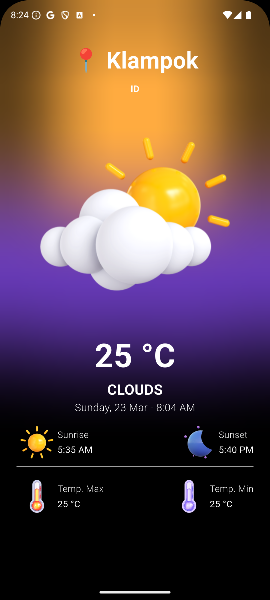

<p align="center">
  
</p>

<h1 align="center">Weather App — BLoC</h1>

<p align="center">
  <b>Cuaca real-time berdasarkan lokasimu.</b><br>
  Flutter · BLoC · OpenWeather
</p>

<p align="center">
  <a href="https://flutter.dev"></a>
  <a href="https://bloclibrary.dev"></a>
  
</p>

---

## ✨ Preview

<p align="center">
  
</p>

<p align="center">
  
</p>

---

## 📖 Tentang

Aplikasi cuaca minimalis: lokasi pengguna dideteksi otomatis, lalu data cuaca real-time
diambil dari OpenWeather API. Dibuat sebagai latihan menerapkan **BLoC** untuk state
management yang scalable dan mudah dirawat.

---

## 🌟 Fitur

- 📍 **Deteksi lokasi otomatis** dengan `geolocator`
- 🌦️ **Cuaca real-time** dari OpenWeather API
- 🔄 **State management BLoC** yang reaktif
- 🔑 **API key aman** lewat `flutter_dotenv`
- 🎨 UI minimalis dan mudah dibaca

---

## 🛠️ Tech Stack

| Area | Pilihan |
|---|---|
| Framework | Flutter |
| State management | `flutter_bloc` 9, `bloc` 9 |
| Lokasi | `geolocator` |
| Cuaca | `weather` 3 |
| Konfigurasi | `flutter_dotenv` |
| Utilitas | `intl`, `equatable` |

---

## 🧱 Struktur

```text
lib/
├── bloc/           # Event, state, dan bloc cuaca
├── data/           # Model & repository cuaca
├── screens/        # Halaman utama
└── main.dart
```

---

## 🚀 Menjalankan

1. Buat file `.env` di root:
   ```env
   OPENWEATHER_API_KEY=your_key_here
   ```
2. Daftarkan `.env` di `pubspec.yaml` pada bagian `assets`.
3. Jalankan:
   ```bash
   flutter pub get
   flutter run
   ```

---

## 🔭 Rencana

- Rekomendasi pakaian berdasarkan cuaca
- Animasi cuaca
- Multi-bahasa

---

## 🧪 Testing

```bash
flutter analyze
flutter test
```
